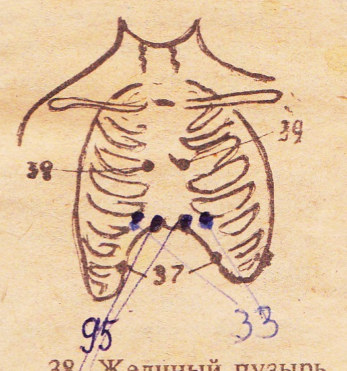

# 38 — Желчный пузырь, сердечные клапаны, поджелудочная железа.

**Сегмент:** [Тулуб — Точки надавливания на туловище](_segment.md) · **Джерело:** стор. 11 (PDF стор. 9)

## Опис

Расположена на правой стороне между третьим и четвертым ребрами у грудины. Эта точка лечит желчный пузырь, некоторые типы запоров, сердечные клапаны, поджелудочную железу и правую часть диафрагмы, а также блуждающие нервы.

## Зображення

*Ребра: 38, 39, 37 (от руки: 95, 33)* — малюнок біля опису, стор. 11

*Ребра: 38, 39, 23, 24, 37* — зведена схема, стор. 10

## У покажчику («Указатель»)

- Разлитие желчи
- Запор
- Переваривание жиров
- Водянка
- Желчный пузырь
- Желчные камни
- Метеоризм
- Сердце: нервы
- Сердце: клапаны
- Расстройство пищеварения
- Желтуха
- Тошнота
- Пепсин
- Диафрагмальный нерв
- Блуждающий нерв

→ [Повний покажчик](../kody/ukazatel.md)
