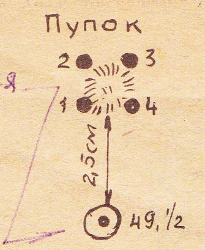
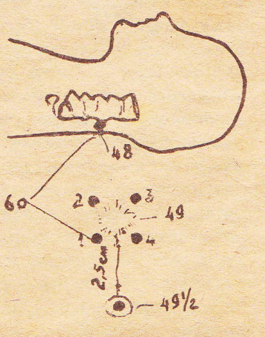
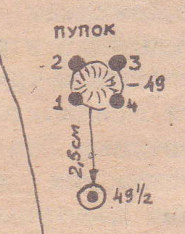

# 49½ — Вздутие живота, мозговые бедренные кости, легкие.

**Сегмент:** [Тулуб — Точки надавливания на туловище](_segment.md) · **Джерело:** стор. 13 (PDF стор. 11)

## Опис

Непосредственно ниже пупка на расстоянии приблизительно 2,5 см находится еще один энергетический центр, который является наиболее мощным в поддержании жизненных сил благодаря своему действию на большие мозговые бедренные кости, которые, в свою очередь, излучают энергию вверх через оба легких. Проверьте эту точку также во всех случаях вздутия живота. Многие люди имеют хронические боли в бедрах, которые фактически являются результатом нарушения равновесия жизненных сил в мозговой бедренной кости или результатом легочных проблем на той же стороне тела. Застой крови в левом легком может привести к одной из форм нарушения сердечного равновесия, а также к головокружению.

## Примітки транскрипції

- У книзі код надруковано як «49,1/2» (у покажчику — «49,1/2» або «49 1/2»).

## Зображення

*Пупок: 49 (1-4), 49½* — малюнок біля опису, стор. 13

*Точка 60: одновременно 48 и пупок* — малюнок біля опису, стор. 13

*Пупок: 49 (1-4), 49½* — зведена схема, стор. 10

## У покажчику («Указатель»)

- Отек брюшной полости
- Дыхание
- Цистит
- Головокружение
- Обморок
- Сердце: эмоциональные
- Легкие
- Боль: кости
- Боль: бедра
- Половые органы

→ [Повний покажчик](../kody/ukazatel.md)
