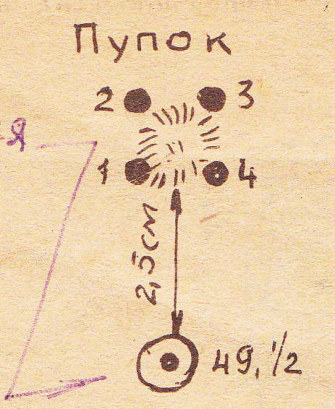
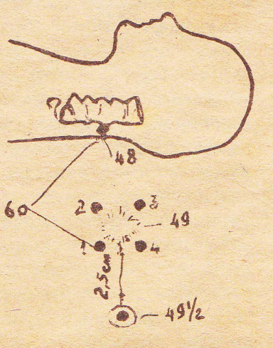
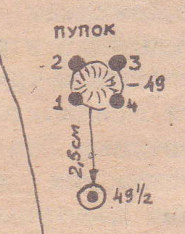

# 49 — Брюшная аорта, пищеварение, сердце, психические заболевания.

**Сегмент:** [Тулуб — Точки надавливания на туловище](_segment.md) · **Джерело:** стор. 13 (PDF стор. 11) · **Соматична точка**

## Опис

Через пупок жизненные жидкости переносятся к неродившемуся ребенку до его рождения. После родов эта пупочная область сохраняет свою жизненную важность для продолжения жизни существа, т.к. непосредственно вокруг пупка и прикасаясь к нему расположены 4 точки, которые поддерживают в рабочем порядке 12-перстную кишку. 12-перстная кишка, которая следует за выходной, или пилорической частью желудка, является центральным местом пищеварительного процесса. Именно здесь артериальная кровь воспринимает электрическую силу нашей пищи и питья и переносит ее к каждой части нашего тела и в мозг. Поэтому, когда вам требуется обработать точки "49", вы одновременно можете почувствовать влияние такой обработки на любой другой орган или органы тела, или на мозг. Не забывайте про точки "49" во всех случаях пищеварительных заболеваний: метеоризма, несварения желудка, язвы 12-перстной кишки, нарушения кальциевого обмена, жирового, сахарного и углеводного обмена; если у вас болит сердце, если вы испытываете хронические боли в спине, а также при нарушении психики. Даже ребенок может испытывать беспокойство в этих точках из-за неправильного питания матери во время беременности. Помните - самая лучшая пища в мире может и будет бесполезной, если вы не можете переваривать ее... В этом вам помогут точки "49".

Каждая точка действует приблизительно на 7,5 см 12-перстной кишки, они обозначены "1", "2", "3" и ["4"](../01-golova/4.md). Точки "3" и ["4"](../01-golova/4.md) с левой стороны пупка действуют также на брюшную аорту, при надавливании пальцем вы почувствуете ее сильную пульсацию. Проверьте также желчный пузырь и желчные протоки т. ["38"](38.md) (стр. 11) и ["54"](54.md) (стр. 13), а также поджелудочную железу ["14B"](../01-golova/14B.md) (стр. 8) и ["23"](23.md) (стр. 13).

## Зображення

*Пупок: 49 (1-4), 49½* — малюнок біля опису, стор. 13

*Точка 60: одновременно 48 и пупок* — малюнок біля опису, стор. 13

*Пупок: 49 (1-4), 49½* — зведена схема, стор. 10

## У покажчику («Указатель»)

- Спайки
- Анемия
- Аневризма — (3 и 4)
- Брюшная аорта — (3 и 4)
- Апоплексия
- Кровяное давление, низкое
- Кальций
- Переваривание жиров
- Переваривание сахара
- Головокружение
- Язва 12-перстной кишки
- 12-перстная кишка
- Диспепсия
- Эпилепсия
- Пищевое отравление
- Метеоризм
- Сердце: аорта — (3 и 4)
- Сердце: пищеварительные причины
- Геморрой
- Грыжа
- Кишечник
- Рассеянный склероз
- Шея
- Боль: спина
- Прямая кишка
- Переломы

→ [Повний покажчик](../kody/ukazatel.md)
