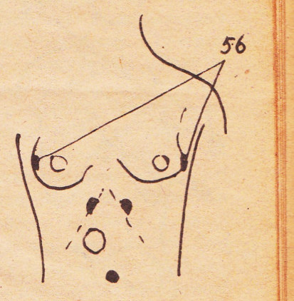
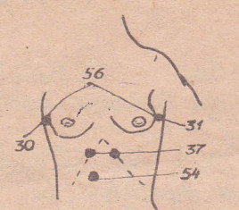

# 56 — Система размножения.

**Сегмент:** [Тулуб — Точки надавливания на туловище](_segment.md) · **Джерело:** стор. 11 (PDF стор. 9)

## Опис

Точки ["30"](30.md) и ["31"](31.md) расположены под руками на уровне сосков. Точки 56 расположены впереди этих двух точек по краям грудных желез. Точки "56" - главные точки, влияющие на всю систему размножения в целом у мужчин и женщин: грудные железы, яичники, предстательная железа, семенные канатики, яички, маточные трубы, матка, шейка матки и щитовидная железа. Органы размножения могут влиять на эмоциональную систему.

## Рукописні нотатки власника

- Від руки біля заголовка: «емоції».

## Зображення

*Грудь: 56* — малюнок біля опису, стор. 11

*Грудь: 56, 30, 31, 37, 54* — зведена схема, стор. 10

## У покажчику («Указатель»)

- Атаксия
- Грудь
- Фаллопиевы трубы
- Половые железы
- Гормоны
- Импотенция
- Менструация
- Менструальные боли
- Шея
- Яичники
- Предстательная железа
- Половые органы
- Секс
- Яички
- Щитовидная железа
- Матка

→ [Повний покажчик](../kody/ukazatel.md)
