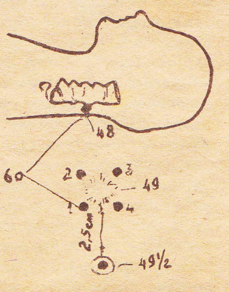

# 60 — Запор.

**Сегмент:** [Тулуб — Точки надавливания на туловище](_segment.md) · **Джерело:** стор. 13 (PDF стор. 11)

## Опис

Надавливание двух точек (["48"](../02-shyya/48.md) и пупок) одновременно двумя руками. Указательный палец одной руки накладывают на точку ["48"](../02-shyya/48.md), а большой палец другой руки - на пупок и давят одновременно довольно сильно. В нижней части живота постепенно образуется довольно значительная теплота.

## Зображення

*Точка 60: одновременно 48 и пупок* — малюнок біля опису, стор. 13

## У покажчику («Указатель»)

- Запор

→ [Повний покажчик](../kody/ukazatel.md)
