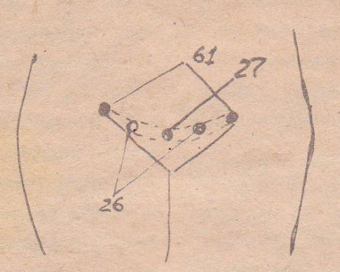
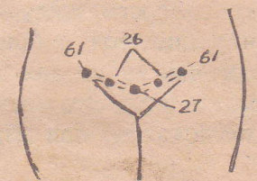

# 61 — Кровообращение.

**Сегмент:** [Тулуб — Точки надавливания на туловище](_segment.md) · **Джерело:** стор. 14 (PDF стор. 12)

## Опис

Точка парная, расположена в паху в начале лобковых костей. Чувствительность или боль в этих точках указывает на недостаточное кровообращение от ног и ступней к сердцу. В случаях варикозных вен, язв на ногах и других нарушений в ногах и ступнях прежде всего надо проверить точку "61".

## Зображення

*Пах: 61, 27, 26* — малюнок біля опису, стор. 14

*Пах: 61, 26, 27* — зведена схема, стор. 10

## У покажчику («Указатель»)

- Лодыжка
- Кровообращение
- Стопа
- Высокое кровяное давление
- Кровообращение в ногах
- Боли в ногах
- Язвы на ногах
- Ноги, увеличенные
- Боль: ноги
- Флебит
- Вены

→ [Повний покажчик](../kody/ukazatel.md)
