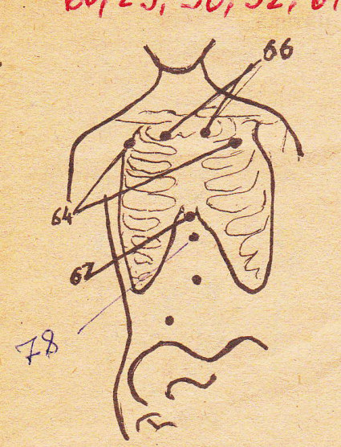
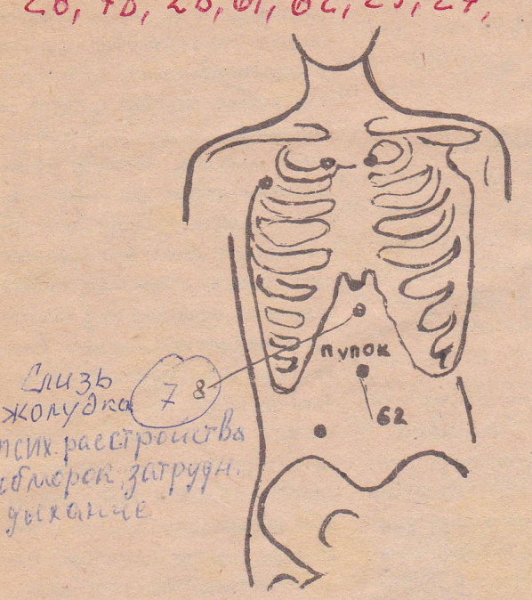

# 62 — Мочевой пузырь, потеря энергии, беспокойство.

**Сегмент:** [Тулуб — Точки надавливания на туловище](_segment.md) · **Джерело:** стор. 14 (PDF стор. 12) · **Соматична точка**

## Опис

Расположена на 2,5 см выше пупка. Действует на солнечное сплетение, специфична при лечении недержания мочи, при задержке мочеиспускания, а также при шоке. Снимает беспокойство, повышает энергию организма.

## Зображення

*Реберная клетка: 66, 64, 62 (от руки: 78)* — малюнок біля опису, стор. 12

*Реберная клетка: 78, 62 (с рукописной заметкой)* — малюнок біля опису, стор. 14

*Реберная клетка: 66, 64, 67, 78, 62, 65* — зведена схема, стор. 10

## У покажчику («Указатель»)

- Морская болезнь
- Солнечное сплетение
- Задержка мочеиспускания

→ [Повний покажчик](../kody/ukazatel.md)
