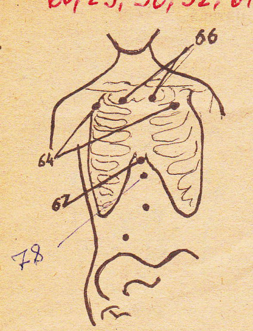

# 64 — Соматическая. Артериальное кровообращение, столбняк, табачное отравление.

**Сегмент:** [Тулуб — Точки надавливания на туловище](_segment.md) · **Джерело:** стор. 12 (PDF стор. 10) · **Соматична точка**

## Опис

Расположена по обеим сторонам верхней грудной области на конце вторых ребер, где они проходят под ключицу. Влияет на артериальное кровообращение в легких, кишечнике и толстой кишке. Особенно показана при табачном отравлении и столбняке.

## Рукописні нотатки власника

- В покажчику дописано від руки: «табачное отравление 64».

## Зображення

*Реберная клетка: 66, 64, 62 (от руки: 78)* — малюнок біля опису, стор. 12

*Реберная клетка: 66, 64, 67, 78, 62, 65* — зведена схема, стор. 10

## У покажчику («Указатель»)

- табачное отравление (рукописне)

→ [Повний покажчик](../kody/ukazatel.md)
