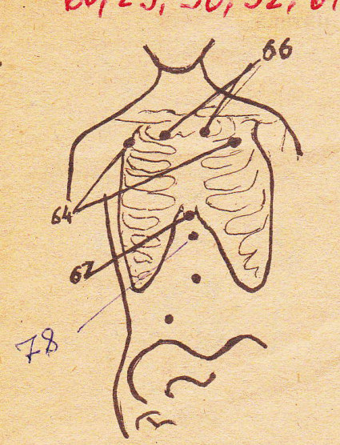

# 66 — Боль в спине, легкие.

**Сегмент:** [Тулуб — Точки надавливания на туловище](_segment.md) · **Джерело:** стор. 12 (PDF стор. 10)

## Опис

Расположены между ключицей и первым ребром, примыкающим к грудине. Лечит легкие и бронхи (верхнюю часть легких), а также боли в спине.

## Зображення

*Реберная клетка: 66, 64, 62 (от руки: 78)* — малюнок біля опису, стор. 12

*Реберная клетка: 66, 64, 67, 78, 62, 65* — зведена схема, стор. 10

## У покажчику («Указатель»)

- Дыхание
- Бронхи
- Грипп, грудь
- Легкие

→ [Повний покажчик](../kody/ukazatel.md)
