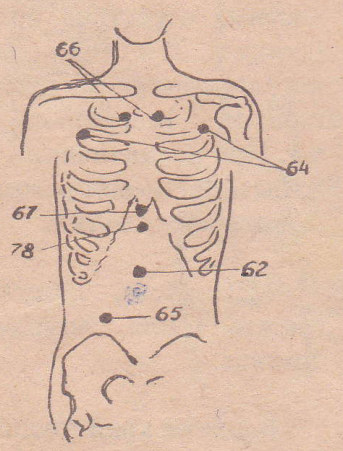

# 67 — Закупорка вен.

**Сегмент:** [Тулуб — Точки надавливания на туловище](_segment.md) · **Джерело:** стор. 12 (PDF стор. 10)

## Опис

Расположена на конце грудины. Используется при закупорке вен.

## Зображення

*Грудь: S1, S2, S3 (от руки: 33, 67)* — малюнок біля опису, стор. 12

*Реберная клетка: 66, 64, 67, 78, 62, 65* — зведена схема, стор. 10

## У покажчику («Указатель»)

_Не згадується._

→ [Повний покажчик](../kody/ukazatel.md)
