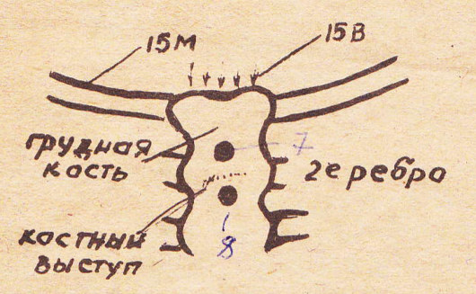
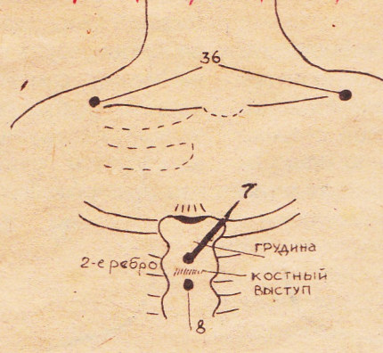
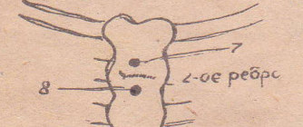

# 7 — Мочевой пузырь, водянка, ребра, вилочковая (зобная) железа.

**Сегмент:** [Тулуб — Точки надавливания на туловище](_segment.md) · **Джерело:** стор. 11 (PDF стор. 9)

## Опис

На задневерхней четверти грудной кости, или грудины, при ощупывании можно обнаружить костную бороздку, или выпуклость, которая тянется от одной стороны к другой. Как раз над серединой этой бороздки расположена точка, связанная с той частью тонких кишек, которая влияет на вздутие живота, на задержку воды и водянку, а также на условия, вызывающие чрезмерное опухание лодыжек и ног. Эта точка связана с зобной железой, лечит ребра и мочевой пузырь.

## Зображення

*Грудная кость, 2-е ребра: 15M, 15B (от руки: 7, 8)* — малюнок біля опису, стор. 9

*Ключицы и грудина: 36, 7, 8* — малюнок біля опису, стор. 11

*Грудина: 7, 8* — зведена схема, стор. 10

## У покажчику («Указатель»)

- Кости
- Переваривание белков
- Водянка
- Кишечник
- Почки
- Ноги, увеличенные
- Боль: кости
- Ребра
- Зобная железа
- Отеки
- Задержка мочеиспускания

→ [Повний покажчик](../kody/ukazatel.md)
