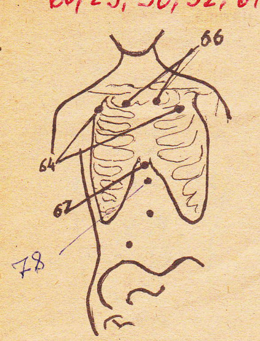
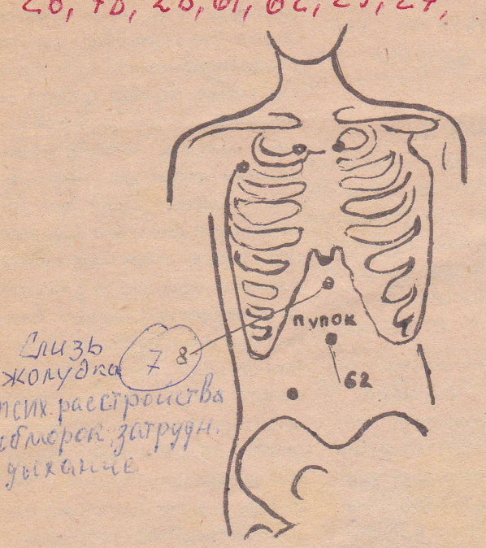

# 78 — Солнечное сплетение, психические расстройства.

**Сегмент:** [Тулуб — Точки надавливания на туловище](_segment.md) · **Джерело:** стор. 14 (PDF стор. 12) · **Соматична точка**

## Опис

Расположена на 2,5 см ниже конца грудины. Эта точка используется для солнечного сплетения, кишечника, при психических расстройствах, обмороке, затрудненном и болезненном дыхании и некоторых типах несварения желудка.

## Рукописні нотатки власника

- Від руки біля малюнка: «Слизь желудка, псих. расстройства, обморок, затрудн. дыхание».

## Примітки транскрипції

- У друці заголовок починається з «8.» (перша цифра не пропечаталась); від руки виправлено на «78». Код 78 підтверджується малюнком і покажчиком («Солнечное сплетение-62,78», «Психический центр-78»).

## Зображення

*Реберная клетка: 66, 64, 62 (от руки: 78)* — малюнок біля опису, стор. 12

*Реберная клетка: 78, 62 (с рукописной заметкой)* — малюнок біля опису, стор. 14

*Реберная клетка: 66, 64, 67, 78, 62, 65* — зведена схема, стор. 10

## У покажчику («Указатель»)

- Кровяное давление, низкое
- Энергия
- Печальное настроение
- Изжога
- Сердце: пищеварительные причины
- Расстройство пищеварения
- Кишечник
- Пепсин
- Психический центр
- Морская болезнь
- Солнечное сплетение

→ [Повний покажчик](../kody/ukazatel.md)
