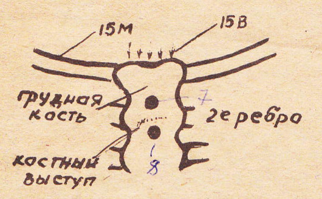
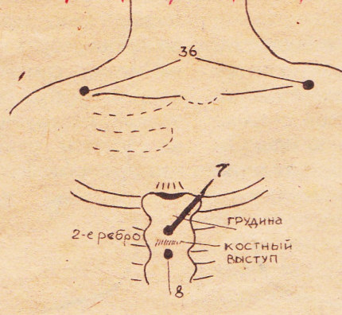
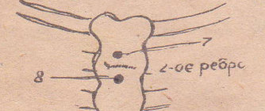

# 8 — Повышенная кислотность, дыхание, давление крови в сердечной мышце, слизистая.

**Сегмент:** [Тулуб — Точки надавливания на туловище](_segment.md) · **Джерело:** стор. 11 (PDF стор. 9)

## Опис

Расположена приблизительно на 2,5 см ниже точки ["7"](7.md) или ниже костной борозды, проходящей через грудину. Лечит повышенную кислотность, изжогу, выбрасывает слизь из желудка, а также излечивает кашель, икоту, астму и дифтерию. Точка "8" лечит также ребра и сердечное давление.

## Зображення

*Грудная кость, 2-е ребра: 15M, 15B (от руки: 7, 8)* — малюнок біля опису, стор. 9

*Ключицы и грудина: 36, 7, 8* — малюнок біля опису, стор. 11

*Грудина: 7, 8* — зведена схема, стор. 10

## У покажчику («Указатель»)

- Повышенная кислотность
- Астма
- Отрыжка
- Кости
- Кашель
- Диафрагма
- Дифтерия
- Изжога
- Икота
- Слизистая
- Боль: кости
- Ребра
- Желудок
- Слизистая желудка

→ [Повний покажчик](../kody/ukazatel.md)
