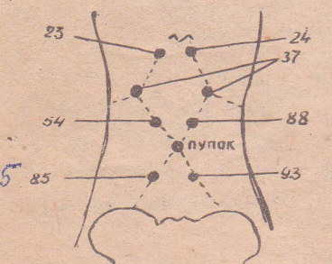

# 88 — Запор, сильное сердцебиение.

**Сегмент:** [Тулуб — Точки надавливания на туловище](_segment.md) · **Джерело:** стор. 13 (PDF стор. 11)

## Опис

Расположена точно там же, где точка ["54"](54.md), но на противоположной стороне брюшной полости. Это точка, которая выпускает содержимое кишечника. Лечит запоры. Если точка ["54"](54.md) также болезненна, то нажимайте на обе точки одновременно. Точка "88" - это также специфическая точка для лечения сильного сердцебиения.

## Зображення

*Живот: 23, 24, 37, 54, 88, 65, 93* — малюнок біля опису, стор. 13

*Живот: 23, 24, 37, 54, 88, 65, 93* — зведена схема, стор. 10

## У покажчику («Указатель»)

- Запор
- Эпилепсия
- Сердце: пищеварительные причины
- Сердце: сердцебиение сильное
- Кишечник
- Рассеянный склероз
- Нервозность
- Пульс,снизить

→ [Повний покажчик](../kody/ukazatel.md)
