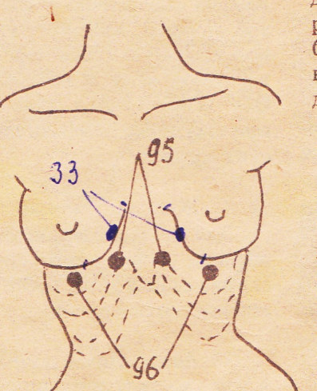
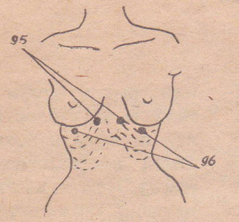

# 95 — Сердце.

**Сегмент:** [Тулуб — Точки надавливания на туловище](_segment.md) · **Джерело:** стор. 11 (PDF стор. 9)

## Опис

Используйте эту точку для лечения сердца. Она расположена между 5-ым и 6-ым ребрами под грудью и влияет на гормоны, воздействующие на сердце.

## Зображення

*Ребра: 38, 39, 37 (от руки: 95, 33)* — малюнок біля опису, стор. 11

*Грудь: 95, 96 (от руки: 33)* — малюнок біля опису, стор. 11

*Грудь: 95, 96* — зведена схема, стор. 10

## У покажчику («Указатель»)

- Гормоны

→ [Повний покажчик](../kody/ukazatel.md)
