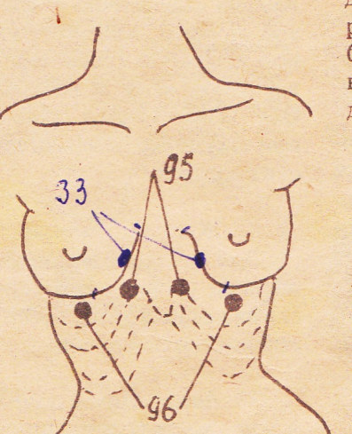
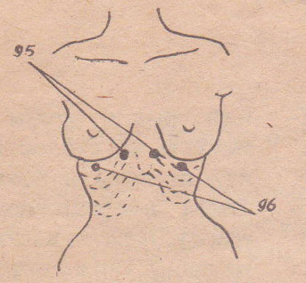

# 96 — Бронхи, легкие.

**Сегмент:** [Тулуб — Точки надавливания на туловище](_segment.md) · **Джерело:** стор. 11 (PDF стор. 9)

## Опис

Эти точки лечат большую часть легких и бронхи. Они расположены непосредственно под сосками грудных желез.

## Зображення

*Грудь: 95, 96 (от руки: 33)* — малюнок біля опису, стор. 11

*Грудь: 95, 96* — зведена схема, стор. 10

## У покажчику («Указатель»)

- Дыхание
- Бронхи
- Легкие

→ [Повний покажчик](../kody/ukazatel.md)
