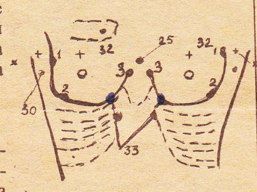

# X — Кровь: левая — артериальная, правая — венозная.

**Сегмент:** [Тулуб — Точки надавливания на туловище](_segment.md) · **Джерело:** стор. 12 (PDF стор. 10) · **Соматична точка**

## Опис

Для венозной и артериальной крови. Левая "X" расположена в подмышечной ямке левой руки в ее наивысшей точке, которую вы вполне можете нащупать у ребер. Она связана со всей артериальной кровью через аорту, сердце и тело. Правая "X" расположена аналогично с правой стороны, действует на всю венозную кровь через воротную вену и печень. Обе используются также при закупорке лимфатических сосудов.

## Рукописні нотатки власника

- У покажчику біля «Кровотечение-2B, положительные ионы» дописано від руки: «RTX».

## Примітки транскрипції

- У книзі окремого заголовка для «X» немає: опис іде абзацом усередині статті про точку 32. Заголовок складено за текстом і розділом «Обозначения» покажчика («X - кровь»). У списку соматичних точок позначена як LT-X (ліва) та RT-X (права).

## Зображення

*Грудь: 25, 32, 30, 33* — малюнок біля опису, стор. 12

*Грудь: S1, S2, S3 (от руки: 33, 67)* — малюнок біля опису, стор. 12

*Туловище спереди: сводная схема* — зведена схема, стор. 10

## У покажчику («Указатель»)

- Артериальная кровь — левая
- Кровь артериальная — левая
- Кровь венозная — правая
- Тело, слишком холодное — левая
- Тело, слишком горячее — правая
- Простуда — левая
- Кровообращение — левая
- Кровообращение — правая
- Энергия — левая
- Сердце: кровообращение — левая
- Желтуха — левая

→ [Повний покажчик](../kody/ukazatel.md)
