# Тулуб — Точки надавливания на туловище

Сторінки джерела: 10–14.

## Точки

| Код | Заголовок | Стор. | Малюнків |
|---|---|---|---|
| [36](36.md) | Боли в руках, шее и плечах, дыхание, кровообращение. | 11 | 2 |
| [7](7.md) | Мочевой пузырь, водянка, ребра, вилочковая (зобная) железа. | 11 | 3 |
| [8](8.md) | Повышенная кислотность, дыхание, давление крови в сердечной мышце, слизистая. | 11 | 3 |
| [38](38.md) | Желчный пузырь, сердечные клапаны, поджелудочная железа. | 11 | 2 |
| [39](39.md) | Сердечные клапаны, слизистая. | 11 | 2 |
| [37](37.md) | Передняя часть реберной клетки. Сильное сердцебиение, задержка мочеиспускания. | 11 | 5 |
| [56](56.md) | Система размножения. | 11 | 2 |
| [95](95.md) | Сердце. | 11 | 3 |
| [96](96.md) | Бронхи, легкие. | 11 | 2 |
| [66](66.md) | Боль в спине, легкие. | 12 | 2 |
| [64](64.md) | Соматическая. Артериальное кровообращение, столбняк, табачное отравление. | 12 | 2 |
| [67](67.md) | Закупорка вен. | 12 | 2 |
| [25](25.md) | Сердце. | 12 | 2 |
| [30](30.md) | Печень. | 12 | 2 |
| [32](32.md) | Левая: артерии толстой кишки, кишечника, сердца. Правая: вены, ведущие к толстой кишке и кишечнику. | 12 | 2 |
| [X](X.md) | Кровь: левая — артериальная, правая — венозная. | 12 | 3 |
| [31](31.md) | Желудок, эмоции. | 12 | 2 |
| [33](33.md) | Левая: левая почка и левая часть толстой кишки. Правая: правая почка и правая часть толстой кишки. | 12 | 5 |
| [S1](S1.md) | Правая: повышенная кислотность, грудная железа, вены. Левая: аорта, грудная железа, упадок энергии, сердечное давление, лимфа. | 12 | 3 |
| [S2](S2.md) | Правая: грудная железа, печень. Левая: грудная железа, застой крови в сердце, сердечное давление, лимфа. | 12 | 3 |
| [S3](S3.md) | Правая: грудная железа, уши, глухота, звон в ушах, печень. Левая: грудная железа, одутловатость, уши, сердечное давление, расстройство желудка, лимфа, желудок, прямая кишка. | 12 | 3 |
| [23](23.md) | Поджелудочная железа. | 13 | 5 |
| [24](24.md) | Селезенка. | 13 | 5 |
| [54](54.md) | Желчь, пищеварение, желчные камни. | 13 | 3 |
| [65](65.md) | Аппендицит, толстая кишка, инсулин. | 13 | 3 |
| [88](88.md) | Запор, сильное сердцебиение. | 13 | 2 |
| [93](93.md) | Запор. | 13 | 2 |
| [49½](49-half.md) | Вздутие живота, мозговые бедренные кости, легкие. | 13 | 3 |
| [49](49.md) | Брюшная аорта, пищеварение, сердце, психические заболевания. | 13 | 3 |
| [60](60.md) | Запор. | 13 | 1 |
| [78](78.md) | Солнечное сплетение, психические расстройства. | 14 | 3 |
| [62](62.md) | Мочевой пузырь, потеря энергии, беспокойство. | 14 | 3 |
| [28](28.md) | Отеки. | 14 | 2 |
| [29](29.md) | Пенис или влагалище. | 14 | 2 |
| [61](61.md) | Кровообращение. | 14 | 2 |
| [27](27.md) | Предстательная железа (простата) или матка. | 14 | 3 |
| [26](26.md) | Яичники, маточные трубы, семенные канатики. | 14 | 3 |

## Рукописні переліки точок угорі сторінок (червоним)

- стор. 11: 36, 7, 8, 37, 38, 39, 56, 95, 96
- стор. 12: 66, 25, 30, 32, 64, 67, 31, 33, S1, S2, S3
- стор. 13: 23, 54, 65, 24, 88, 93, 49, 1, 2, 3, 4, 60
- стор. 14: 26, 78, 28, 61, 62, 29, 27

## Зведені схеми

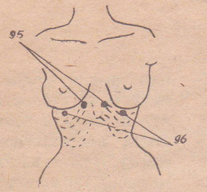

*Грудь: 95, 96* (стор. 10) — точки: [95](95.md), [96](96.md)

*Грудь: 56, 30, 31, 37, 54* (стор. 10) — точки: [56](56.md), [30](30.md), [31](31.md), [37](37.md), [54](54.md)

*Живот: 23, 24, 37, 54, 88, 65, 93* (стор. 10) — точки: [23](23.md), [24](24.md), [37](37.md), [54](54.md), [88](88.md), [65](65.md), [93](93.md)

*Реберная клетка: 66, 64, 67, 78, 62, 65* (стор. 10) — точки: [66](66.md), [64](64.md), [67](67.md), [78](78.md), [62](62.md), [65](65.md)

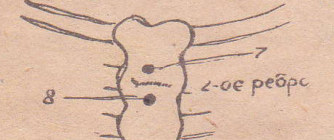

*Грудина: 7, 8* (стор. 10) — точки: [7](7.md), [8](8.md)

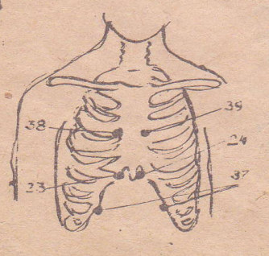

*Ребра: 38, 39, 23, 24, 37* (стор. 10) — точки: [38](38.md), [39](39.md), [23](23.md), [24](24.md), [37](37.md)

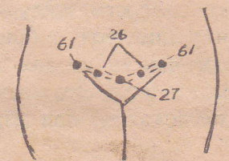

*Пах: 61, 26, 27* (стор. 10) — точки: [61](61.md), [26](26.md), [27](27.md)

*Туловище спереди: сводная схема* (стор. 10) — точки: [36](36.md), [33](33.md), [25](25.md), [32](32.md), [X](X.md), [S1](S1.md), [S2](S2.md), [S3](S3.md), [31](31.md), [23](23.md), [24](24.md), [26](26.md), [27](27.md)

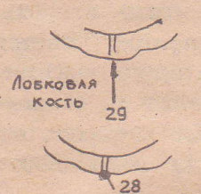

*Лобковая кость: 29, 28* (стор. 10) — точки: [29](29.md), [28](28.md)

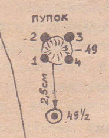

*Пупок: 49 (1-4), 49½* (стор. 10) — точки: [49](49.md), [49½](49-half.md)

## Малюнки біля описів

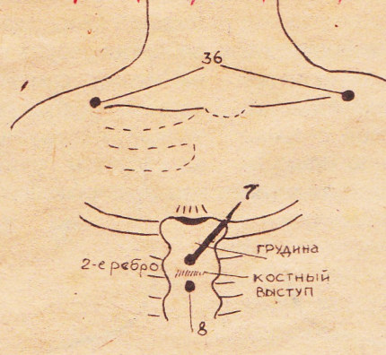

*Ключицы и грудина: 36, 7, 8* (стор. 11) — точки: [36](36.md), [7](7.md), [8](8.md)

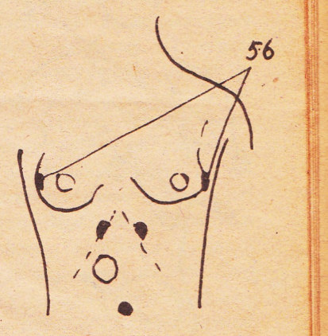

*Грудь: 56* (стор. 11) — точки: [56](56.md)

*Ребра: 38, 39, 37 (от руки: 95, 33)* (стор. 11) — точки: [38](38.md), [39](39.md), [37](37.md), [95](95.md), [33](33.md)

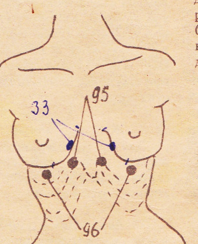

*Грудь: 95, 96 (от руки: 33)* (стор. 11) — точки: [33](33.md), [95](95.md), [96](96.md)

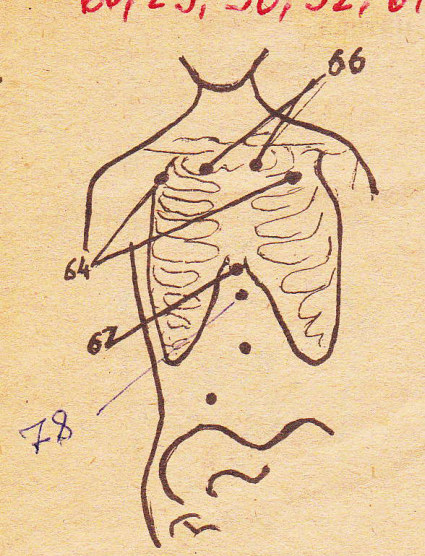

*Реберная клетка: 66, 64, 62 (от руки: 78)* (стор. 12) — точки: [66](66.md), [64](64.md), [62](62.md), [78](78.md)

*Грудь: 25, 32, 30, 33* (стор. 12) — точки: [25](25.md), [32](32.md), [30](30.md), [33](33.md), [X](X.md), [S1](S1.md), [S2](S2.md), [S3](S3.md)

*Грудь: S1, S2, S3 (от руки: 33, 67)* (стор. 12) — точки: [S1](S1.md), [S2](S2.md), [S3](S3.md), [33](33.md), [67](67.md), [X](X.md)

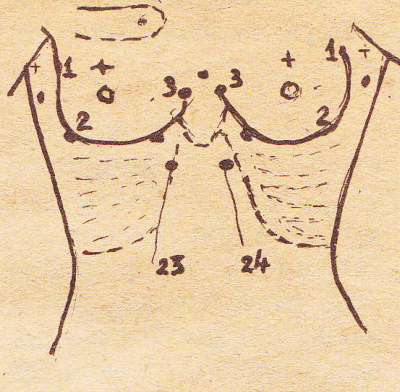

*Края ребер: 23, 24* (стор. 13) — точки: [23](23.md), [24](24.md)

*Живот: 23, 24, 37, 54, 88, 65, 93* (стор. 13) — точки: [23](23.md), [24](24.md), [37](37.md), [54](54.md), [88](88.md), [65](65.md), [93](93.md)

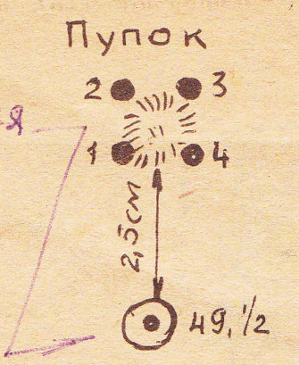

*Пупок: 49 (1-4), 49½* (стор. 13) — точки: [49](49.md), [49½](49-half.md)

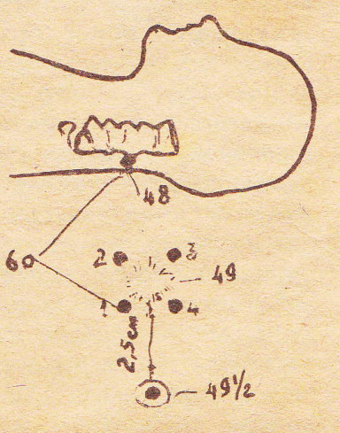

*Точка 60: одновременно 48 и пупок* (стор. 13) — точки: [48](../02-shyya/48.md), [60](60.md), [49](49.md), [49½](49-half.md)

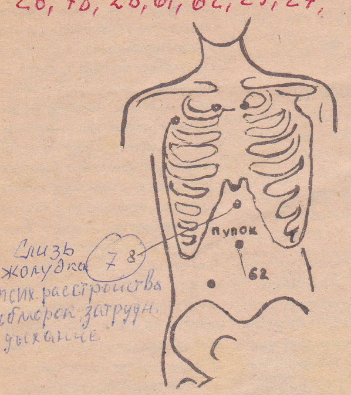

*Реберная клетка: 78, 62 (с рукописной заметкой)* (стор. 14) — точки: [78](78.md), [62](62.md)

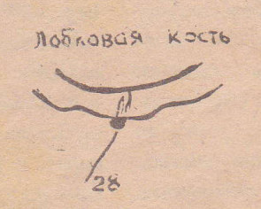

*Лобковая кость: 28* (стор. 14) — точки: [28](28.md)

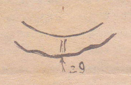

*Лобковая кость: 29* (стор. 14) — точки: [29](29.md)

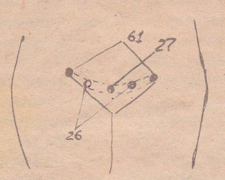

*Пах: 61, 27, 26* (стор. 14) — точки: [61](61.md), [27](27.md), [26](26.md)
