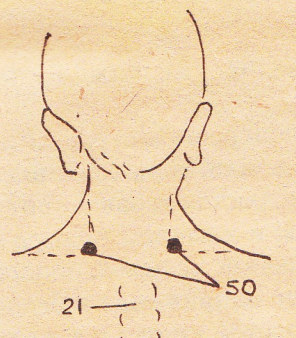
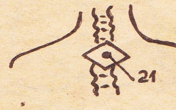
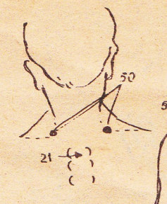
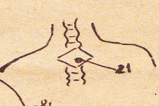

# 21 — 7-й шейный позвонок. Кости, сердце, спинной хребет.

**Сегмент:** [Спина — Точки надавливания на спине](_segment.md) · **Джерело:** стор. 15 (PDF стор. 13) · **Соматична точка**

## Опис

Расположена на остистом отростке 7-го шейного позвонка, где шея соединяется с плечами. Эта точка влияет на гипофиз, щитовидную железу и каждую кость тела. Если у вас перелом или трещина в кости, прикосновение к точке "21" очень болезненно. Точка "21" облегчает боль. Применяется также при расстройстве сердца, спинного мозга и спинно-мозговых нервов.

## Зображення

*Основание шеи: 50, 21* — малюнок біля опису, стор. 15

*7-й шейный позвонок: 21* — малюнок біля опису, стор. 15

*Основание шеи: 50, 21* — зведена схема, стор. 15

*Спина: сводная схема* — зведена схема, стор. 15

*7-й шейный позвонок: 21* — зведена схема, стор. 15

## У покажчику («Указатель»)

- Кости
- Перелом кости
- Перелом
- Голова: боль
- Голова: травма
- Мигрень
- Боль: кости
- Боль: гипофиз
- Боль: ребра
- Гипофиз
- Ребра
- Плечевые кости
- Щитовидная железа

→ [Повний покажчик](../kody/ukazatel.md)
