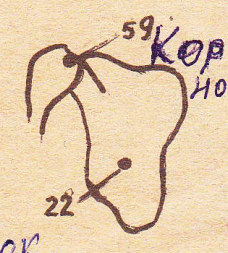
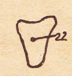

# 22 — Сердце, легкие, грипп.

**Сегмент:** [Спина — Точки надавливания на спине](_segment.md) · **Джерело:** стор. 16 (PDF стор. 14)

## Опис

Парная точка, расположена в центре лопатки. Лечит легкие, сердце и некоторые боли в плечах.

## Зображення

*Лопатка: 59, 22* — малюнок біля опису, стор. 16

*Лопатка: 22* — зведена схема, стор. 15

## У покажчику («Указатель»)

- Дыхание
- Грипп, грудь
- Легкие

→ [Повний покажчик](../kody/ukazatel.md)
