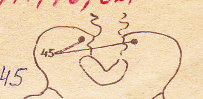
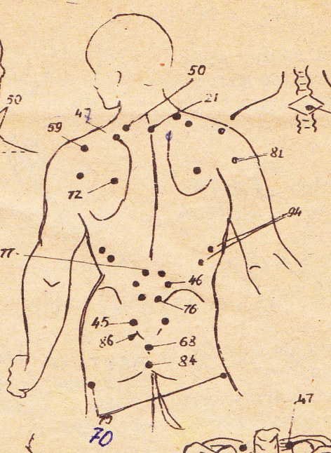
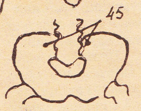

# 45 — Лимфа брюшной полости.

**Сегмент:** [Спина — Точки надавливания на спине](_segment.md) · **Джерело:** стор. 16 (PDF стор. 14)

## Опис

Парная точка, расположена на гребне крестца на подвздошной, или бедренной кости. Эти точки связаны с местом прикрепления ахиллова сухожилия, которое, в свою очередь, влияет на всю лимфу брюшной полости. Лимфа представляет собой прозрачный бесцветный физиологический раствор, который омывает каждую клетку тела. Лимфа не имеет движущей силы, подобной сердцу. Ее движение обуславливается физическим движением тела. Главным двигателем лимфатической жидкости брюшной полости является ахиллово сухожилие, которое тянется от задней части пятки к мышцам, образующим икру ноги, и отсюда к крестцу. Только одна точка еще более эффективна для лечения лимфы брюшной полости: это точка ["73"](../05-ruky-nohy/73.md) (см. стр. 18).

## Рукописні нотатки власника

- Від руки під заголовком: «крутить ноги».

## Примітки транскрипції

- Номер сторінки в посиланні «(см. стр. …)» у друці нечіткий і надписаний від руки як 18 (точка 73 справді описана на стор. 18).

## Зображення

*Таз: 45* — малюнок біля опису, стор. 16

*Спина: сводная схема* — зведена схема, стор. 15

*Таз: 45* — зведена схема, стор. 15

## У покажчику («Указатель»)

- Лимфатические сосуды брюшной полости
- Ахиллово сухожилие
- Лимфа

→ [Повний покажчик](../kody/ukazatel.md)
