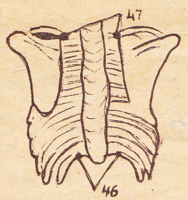
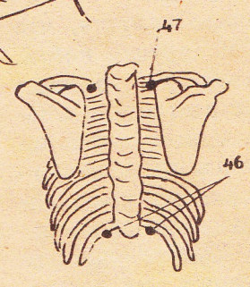

# 46 — Сердце, дыхание, боли.

**Сегмент:** [Спина — Точки надавливания на спине](_segment.md) · **Джерело:** стор. 15 (PDF стор. 13)

## Опис

Расположена в нижней части реберной клетки (на 12-ом ребре) на расстоянии около 7,5 см от спинного хребта. Я не могу преувеличить ценность этих точек, т.к. адреналин имеет огромную важность для жизни каждой клетки нашего тела. Лечит сердечные случаи, затрудненное дыхание и боли в любой части тела, особенно в пояснице и ногах.

## Зображення

*Реберная клетка сзади: 47, 46* — малюнок біля опису, стор. 15

*Спина: сводная схема* — зведена схема, стор. 15

*Реберная клетка сзади: 47, 46* — зведена схема, стор. 15

## У покажчику («Указатель»)

- Болезнь Аддисона
- Надпочечники
- Боль в бедре
- Боли в ногах
- Рот
- Боль: спина
- Боль: бедра
- Боль: ноги
- Ишиас

→ [Повний покажчик](../kody/ukazatel.md)
