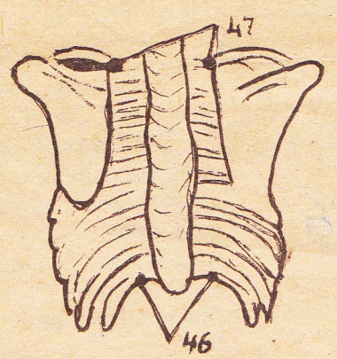
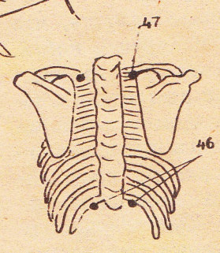

# 47 — Спастические или болезненные руки, ноги, поясница.

**Сегмент:** [Спина — Точки надавливания на спине](_segment.md) · **Джерело:** стор. 15 (PDF стор. 13)

## Опис

Эти точки расположены на верхней стороне лопаток. Давите приблизительно на то место, где второе ребро проходит под лопатку. Помогает при болях в пояснице и ногах, а также при спастических состояниях ног и рук.

## Зображення

*Реберная клетка сзади: 47, 46* — малюнок біля опису, стор. 15

*Спина: сводная схема* — зведена схема, стор. 15

*Реберная клетка сзади: 47, 46* — зведена схема, стор. 15

## У покажчику («Указатель»)

- Бурсит
- Уши
- Плечевые кости
- Шум в ушах

→ [Повний покажчик](../kody/ukazatel.md)
