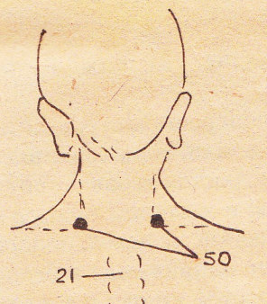
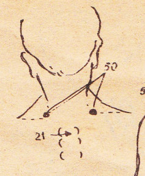

# 50 — Соматическая. Диабет, напряженное состояние.

**Сегмент:** [Спина — Точки надавливания на спине](_segment.md) · **Джерело:** стор. 15 (PDF стор. 13) · **Соматична точка**

## Опис

Попросите друга или члена семьи стать сзади вас и поместить свои большие пальцы у основания вашей шеи с обеих сторон одновременно. Давить надо вверх и вниз под углом 45° в направлении точки ["21"](21.md). Эта точка чувствительна у каждого, т.к. в наше время все страдают от напряженного состояния. Избавляет от застоя крови в шее и мозге и лечит умственную усталость. Используется также для алкогольного отрезвления (для этой цели применяются также точки JB10 см. стр. 8) и лечения бессонницы и диабета.

## Рукописні нотатки власника

- Червоним від руки над заголовком: «алкогольное отрезвление».

## Зображення

*Основание шеи: 50, 21* — малюнок біля опису, стор. 15

*Основание шеи: 50, 21* — зведена схема, стор. 15

*Спина: сводная схема* — зведена схема, стор. 15

## У покажчику («Указатель»)

- Апоплексия
- Руки
- Бурсит
- Диабет
- Алкоголизм
- Эмоции
- Эпилепсия
- Голова: боль
- Голова: травма
- Мигрень
- Мышцы
- Шея
- Боль: голова
- Плечевые кости
- Шум в ушах

→ [Повний покажчик](../kody/ukazatel.md)
