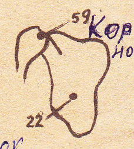
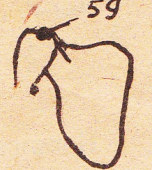

# 59 — Паралич, ушибы, усталость, шок.

**Сегмент:** [Спина — Точки надавливания на спине](_segment.md) · **Джерело:** стор. 16 (PDF стор. 14)

## Опис

Вначале кажется, что точку "59" трудно найти. Надо чтобы кто-то стоял сзади вас, а вы сидели. Своими большими пальцами он должен вести по наружному верхнему краю лопатки до самого ее конца. Пальцы будут ощущать что-то тупое, не острое. Можно большие пальцы поместить на обе точки "59" и давить вверх в направлении спины. Учитывайте эти точки во всех случаях паралича, кровоподтеков в любой части тела, ушибов головы, независимо от того, когда это произошло, физической усталости и всех типов шока, особенно электрического шока и его последствий на сердце. (Давить надо обе точки одновременно).

## Рукописні нотатки власника

- Від руки біля малюнка: «Корчі в ногах» та «Эл. шок».

## Зображення

*Лопатка: 59, 22* — малюнок біля опису, стор. 16

*Спина: сводная схема* — зведена схема, стор. 15

*Лопатка: 59* — зведена схема, стор. 15

## У покажчику («Указатель»)

- Укус животного
- Электрический удар
- Голова: травма
- Удар

→ [Повний покажчик](../kody/ukazatel.md)
