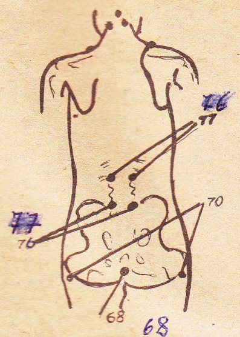
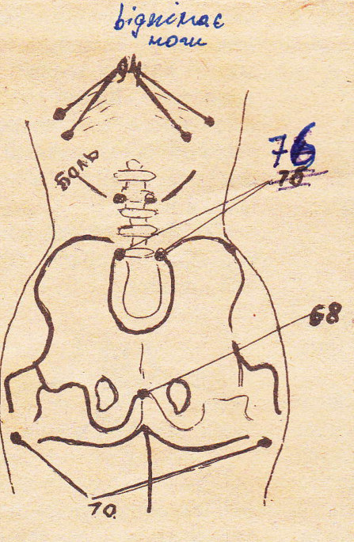
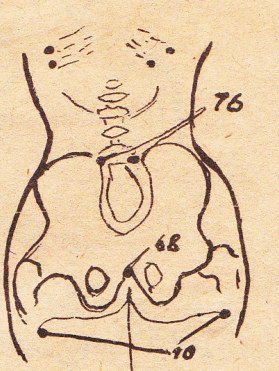
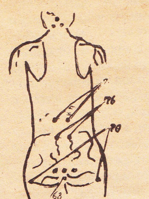

# 68 — Копчик. Энергия, желудок.

**Сегмент:** [Спина — Точки надавливания на спине](_segment.md) · **Джерело:** стор. 16 (PDF стор. 14)

## Опис

Расположена на конце копчиковой кости. Копчиковая кость отражает энергию через таз и органы размножения, желудок и мозг. Давите кончик копчика в направлении головы. Лечит также желудочные болезни.

## Зображення

*Спина: 76, 77, 70, 68* — малюнок біля опису, стор. 16

*Поясница и таз: 76, 68, 70; концы ребер («боль»)* — малюнок біля опису, стор. 16

*Таз сзади: 76, 68, 70* — зведена схема, стор. 15

*Спина: 76, 70, 68* — зведена схема, стор. 15

*Спина: сводная схема* — зведена схема, стор. 15

## У покажчику («Указатель»)

- Анус
- Копчик
- Геморрой
- Инсулин
- Боль: ноги
- Боль: прямая кишка
- Прямая кишка
- Соль
- Мошонка
- Спинной мозг
- Желудок
- Сахар

→ [Повний покажчик](../kody/ukazatel.md)
