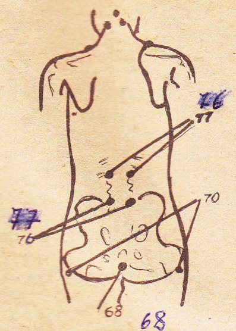

# 77 — Левая: брюшная полость, толстая кишка, желудок, бедра. Правая: аппендикс, желчный пузырь.

**Сегмент:** [Спина — Точки надавливания на спине](_segment.md) · **Джерело:** стор. 16 (PDF стор. 14)

## Опис

### 77. Левая. Брюшная полость, толстая кишка, желудок, бедра.

### 77. Правая. Аппендикс, желчный пузырь.

Расположена на поперечном отростке первого поясничного позвонка. Надавливание на правый поперечный отросток избавляет от застоя крови и от болей в желчном пузыре и в аппендиксе. Надавливание на левый поперечный отросток снимает напряжение в бедрах, брюшной полости, толстой кишке и в желудке.

## Зображення

*Спина: 76, 77, 70, 68* — малюнок біля опису, стор. 16

*Спина: сводная схема* — зведена схема, стор. 15

## У покажчику («Указатель»)

- Аппендицит — правая
- Желчный пузырь — правая
- Желчные камни — правая
- Боль в бедре
- Боли в ногах
- Боль: спина
- Ишиас
- Желудок — левая

→ [Повний покажчик](../kody/ukazatel.md)
