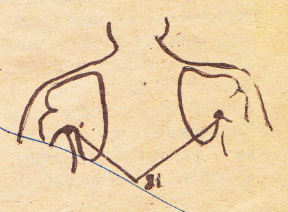
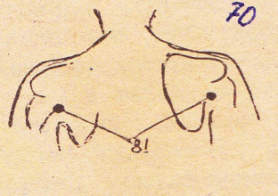

# 81 — Воспаление слизистой сумки.

**Сегмент:** [Спина — Точки надавливания на спине](_segment.md) · **Джерело:** стор. 15 (PDF стор. 13)

## Опис

Расположена на задней части плечевого соединения. Внимательно изучите схему. Это точка, которую практически невозможно достать самому, но это одна из наиболее важных точек для лечения воспаления слизистой сумки и других болезней в плечах и руках. Если необходимо, обработайте также точки левую "15" или ["40"](../05-ruky-nohy/40.md) (см. стр. 19).

## Рукописні нотатки власника

- В покажчику дописано від руки: «Слизистая сумка - 81, 15, 40».

## Примітки транскрипції

- Точки з кодом «15» у книзі немає (є 15B і 15M); у покажчику «Бурсит» містить «15Mлевая» — імовірно, мається на увазі ліва 15M.

## Зображення

*Плечи сзади: 81* — малюнок біля опису, стор. 15

*Спина: сводная схема* — зведена схема, стор. 15

*Плечи сзади: 81* — зведена схема, стор. 15

## У покажчику («Указатель»)

- Руки
- Бурсит
- Легкие
- Слизистая сумка (рукописне)
- Плечевые кости

→ [Повний покажчик](../kody/ukazatel.md)
