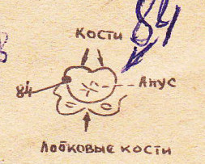
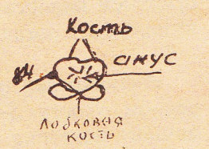

# 84 — Боль в прямой кишке.

**Сегмент:** [Спина — Точки надавливания на спине](_segment.md) · **Джерело:** стор. 16 (PDF стор. 14)

## Опис

Внутренний край нижней тазовой кости образует круг вокруг прямой кишки и ануса. Проведите пальцем по внутреннему краю этого костного круга, в случае болей в прямой кишке найдите на этой кости соответствующую точку. Эта круговая кость расположена на расстоянии около 5 см от ануса в центре. (Другие точки при болях в прямой кишке: ["68"](68.md) (стр. 16) и ["86"](86.md).

## Зображення

*Кости вокруг ануса: 84* — малюнок біля опису, стор. 16

*Спина: сводная схема* — зведена схема, стор. 15

*Кость вокруг ануса: 84* — зведена схема, стор. 15

## У покажчику («Указатель»)

- Анус
- Геморрой
- Боль: прямая кишка
- Прямая кишка
- Половые органы
- Мошонка

→ [Повний покажчик](../kody/ukazatel.md)
