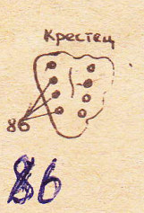
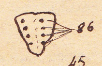

# 86 — Крестец. Симпатическая нервная система спины.

**Сегмент:** [Спина — Точки надавливания на спине](_segment.md) · **Джерело:** стор. 16 (PDF стор. 14)

## Опис

На теле крестца имеются 8 отверстий. Через них проходят нервы, которые являются частью симпатической нервной системы, влияющей на все тело от прямой кишки до мозга. Давите на любую из точек, в которых ощущаете боль. Замечание: если крестцовые нервы болезненны, проверьте половые органы.

## Зображення

*Крестец: 86* — малюнок біля опису, стор. 16

*Спина: сводная схема* — зведена схема, стор. 15

*Крестец: 86* — зведена схема, стор. 15

## У покажчику («Указатель»)

- Боль в бедре
- Прямая кишка
- Половые органы

→ [Повний покажчик](../kody/ukazatel.md)
