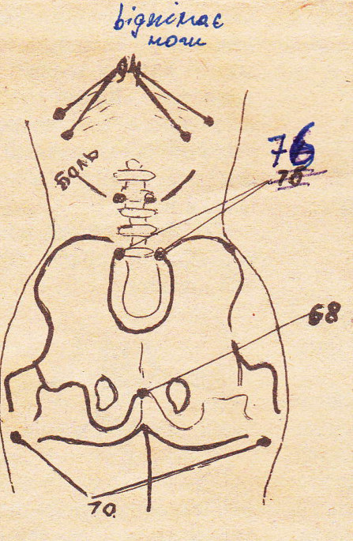

# 94 — (без заголовка) Концы колеблющихся ребер; боли.

**Сегмент:** [Спина — Точки надавливания на спине](_segment.md) · **Джерело:** стор. 16 (PDF стор. 14)

## Опис

Расположены на концах колеблющихся ребер с обеих сторон тела. При болях используйте области "94" и ["76"](76.md).

## Примітки транскрипції

- У книзі стаття починається одразу з «94. Расположены на концах…» — окремого заголовка з показаннями немає.

## Зображення

*Поясница и таз: 76, 68, 70; концы ребер («боль»)* — малюнок біля опису, стор. 16

*Спина: сводная схема* — зведена схема, стор. 15

## У покажчику («Указатель»)

- Сердце: стопа — левая
- Инфекция — левая

→ [Повний покажчик](../kody/ukazatel.md)
