# Спина — Точки надавливания на спине

Сторінки джерела: 15–16.

## Точки

| Код | Заголовок | Стор. | Малюнків |
|---|---|---|---|
| [50](50.md) | Соматическая. Диабет, напряженное состояние. | 15 | 3 |
| [47](47.md) | Спастические или болезненные руки, ноги, поясница. | 15 | 3 |
| [46](46.md) | Сердце, дыхание, боли. | 15 | 3 |
| [21](21.md) | 7-й шейный позвонок. Кости, сердце, спинной хребет. | 15 | 5 |
| [81](81.md) | Воспаление слизистой сумки. | 15 | 3 |
| [22](22.md) | Сердце, легкие, грипп. | 16 | 2 |
| [59](59.md) | Паралич, ушибы, усталость, шок. | 16 | 3 |
| [86](86.md) | Крестец. Симпатическая нервная система спины. | 16 | 3 |
| [45](45.md) | Лимфа брюшной полости. | 16 | 3 |
| [84](84.md) | Боль в прямой кишке. | 16 | 3 |
| [76](76.md) | Напряжение в брюшной полости и пояснице, боли в ногах. | 16 | 5 |
| [77](77.md) | Левая: брюшная полость, толстая кишка, желудок, бедра. Правая: аппендикс, желчный пузырь. | 16 | 2 |
| [94](94.md) | (без заголовка) Концы колеблющихся ребер; боли. | 16 | 2 |
| [70](70.md) | Толстая кишка, боли в ногах. | 16 | 5 |
| [68](68.md) | Копчик. Энергия, желудок. | 16 | 5 |

## Рукописні переліки точок угорі сторінок (червоним)

- стор. 15: 50, 47, 46, 21, 81
- стор. 16: 22, 59, 86, 45, 94, 84, 76, 77, 70, 68

## Зведені схеми

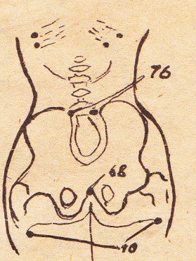

*Таз сзади: 76, 68, 70* (стор. 15) — точки: [76](76.md), [68](68.md), [70](70.md)

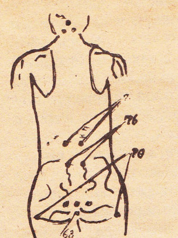

*Спина: 76, 70, 68* (стор. 15) — точки: [76](76.md), [70](70.md), [68](68.md)

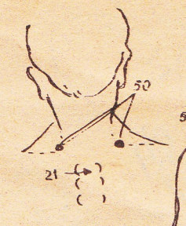

*Основание шеи: 50, 21* (стор. 15) — точки: [50](50.md), [21](21.md)

*Спина: сводная схема* (стор. 15) — точки: [50](50.md), [21](21.md), [59](59.md), [47](47.md), [81](81.md), [94](94.md), [77](77.md), [46](46.md), [76](76.md), [45](45.md), [86](86.md), [68](68.md), [84](84.md), [70](70.md)

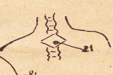

*7-й шейный позвонок: 21* (стор. 15) — точки: [21](21.md)

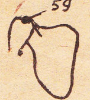

*Лопатка: 59* (стор. 15) — точки: [59](59.md)

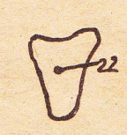

*Лопатка: 22* (стор. 15) — точки: [22](22.md)

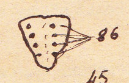

*Крестец: 86* (стор. 15) — точки: [86](86.md)

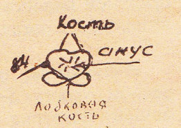

*Кость вокруг ануса: 84* (стор. 15) — точки: [84](84.md)

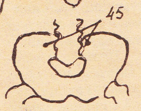

*Таз: 45* (стор. 15) — точки: [45](45.md)

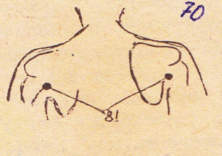

*Плечи сзади: 81* (стор. 15) — точки: [81](81.md)

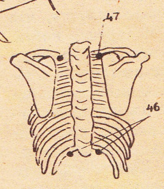

*Реберная клетка сзади: 47, 46* (стор. 15) — точки: [47](47.md), [46](46.md)

## Малюнки біля описів

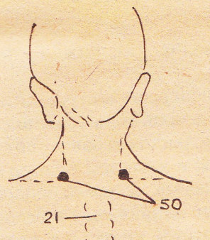

*Основание шеи: 50, 21* (стор. 15) — точки: [50](50.md), [21](21.md)

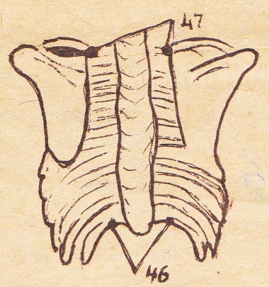

*Реберная клетка сзади: 47, 46* (стор. 15) — точки: [47](47.md), [46](46.md)

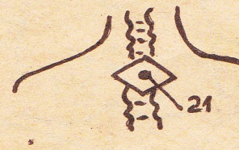

*7-й шейный позвонок: 21* (стор. 15) — точки: [21](21.md)

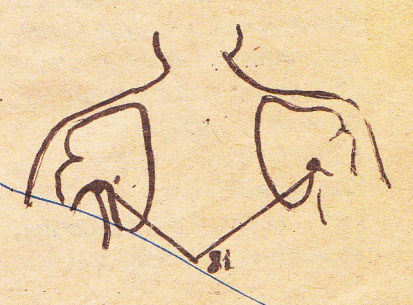

*Плечи сзади: 81* (стор. 15) — точки: [81](81.md)

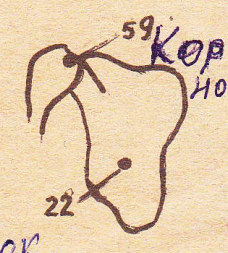

*Лопатка: 59, 22* (стор. 16) — точки: [59](59.md), [22](22.md)

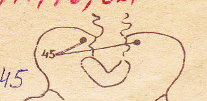

*Таз: 45* (стор. 16) — точки: [45](45.md)

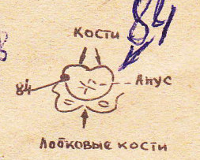

*Кости вокруг ануса: 84* (стор. 16) — точки: [84](84.md)

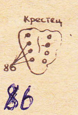

*Крестец: 86* (стор. 16) — точки: [86](86.md)

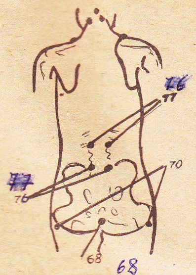

*Спина: 76, 77, 70, 68* (стор. 16) — точки: [76](76.md), [77](77.md), [70](70.md), [68](68.md)

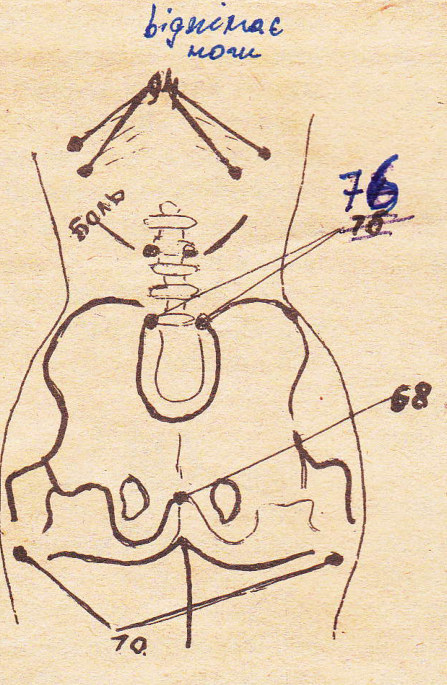

*Поясница и таз: 76, 68, 70; концы ребер («боль»)* (стор. 16) — точки: [76](76.md), [68](68.md), [70](70.md), [94](94.md)
