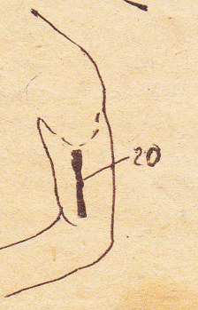
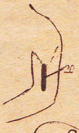

# 20 — Боли в руках, шее, голове, желудке, повышенная кислотность.

**Сегмент:** [Руки і ноги — Точки надавливания на руках и ногах](_segment.md) · **Джерело:** стор. 18 (PDF стор. 16)

## Опис

Эта область расположена на внешней стороне плечевой кости и тянется от локтя до плеча. Надавливать надо на внешнюю сторону самой кости. Лечит застой в желудке. Левая рука связана с левой стороной желудка, правая рука связана с правой стороной желудка. Замечание: желудочные болезни могут вызвать серьезные нарушения деятельности кистей рук. Т. "20" помогает также при болях в руке, шее и голове.

## Зображення

*Плечевая кость: 20* — малюнок біля опису, стор. 18

*Тело сзади: сводная схема* — зведена схема, стор. 17

*Плечевая кость: 20* — зведена схема, стор. 17

## У покажчику («Указатель»)

- Повышенная кислотность
- Руки
- Отрыжка
- Переваривание белков
- Диспепсия
- Дистрофия мышечная
- Пищевод
- Пальцы
- Метеоризм
- Соляная кислота
- Расстройство пищеварения
- Мышцы
- Шея
- Нос
- Привратник желудка
- Желудок
- Язва желудка

→ [Повний покажчик](../kody/ukazatel.md)
