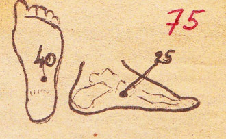
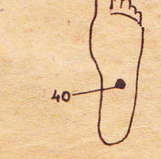

# 40 — Энергия, воспаление.

**Сегмент:** [Руки і ноги — Точки надавливания на руках и ногах](_segment.md) · **Джерело:** стор. 19 (PDF стор. 17)

## Опис

Расположена в середине подошвы стопы впереди пяточного бугра. Через это место энергия земли поступает к человеку и может быть передана в мозг. Эти точки имеют очень большое значение при воспалительных состояниях (аналогично точке ["11B"](../01-golova/11B.md) при инфекциях), также как колиты, циститы, перитониты и флебиты.

## Зображення

*Стопа: 40, 75* — малюнок біля опису, стор. 19

*Подошва: 40* — зведена схема, стор. 17

## У покажчику («Указатель»)

- Бурсит
- Колит
- Понос
- Воспаление
- Перитонит
- Флебит
- Слизистая сумка (рукописне)

→ [Повний покажчик](../kody/ukazatel.md)
