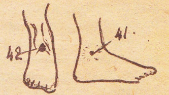
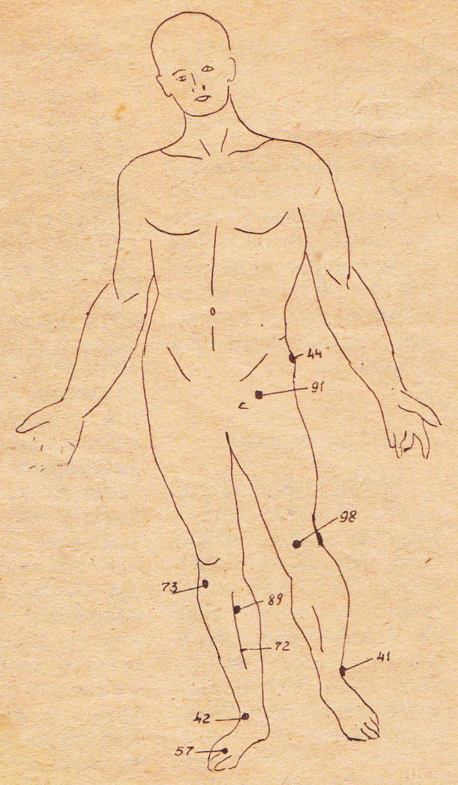
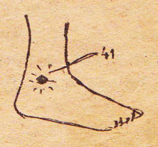

# 41 — СОМАТИЧЕСКАЯ. Застой крови, стопа, энергия.

**Сегмент:** [Руки і ноги — Точки надавливания на руках и ногах](_segment.md) · **Джерело:** стор. 19 (PDF стор. 17) · **Соматична точка**

## Опис

Обрабатывайте место вокруг таранных костей на внутренней и наружной стороне каждой лодыжки. Для лучших результатов всегда нажимайте по внешнему краю таранной кости и на саму кость. Эти точки соматические, т.к. реакция может чувствоваться в любом месте тела от головы до ног. Это место ждет своих исследователей, но нельзя забывать про него при запорах и болезнях стоп. Внутренние точки связаны с энергией тканей тела, внешние - с застоем крови и сокращением мышц. Как только вы начнете лечить эти центры, они становятся очень болезненными, поэтому надо быть осторожным.

## Зображення

*Голеностоп: 42, 41* — малюнок біля опису, стор. 19

*Тело спереди: сводная схема* — зведена схема, стор. 17

*Лодыжка: 41* — зведена схема, стор. 17

## У покажчику («Указатель»)

- Лодыжка
- Костный мозг
- Стопа
- Психика

→ [Повний покажчик](../kody/ukazatel.md)
