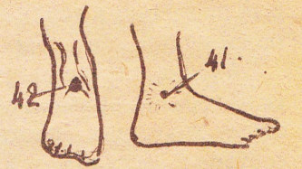
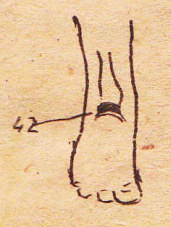

# 42 — Глаза.

**Сегмент:** [Руки і ноги — Точки надавливания на руках и ногах](_segment.md) · **Джерело:** стор. 19 (PDF стор. 17)

## Опис

Расположена между таранной костью и передней стороной большеберцовой кости. Это место непосредственно связано с глазными мышцами. Нажимайте здесь при всех глазных болезнях.

## Зображення

*Голеностоп: 42, 41* — малюнок біля опису, стор. 19

*Тело спереди: сводная схема* — зведена схема, стор. 17

*Голеностоп: 42* — зведена схема, стор. 17

## У покажчику («Указатель»)

- Глаза: косоглазие
- Глаза: слезотечение
- Глаза: мышцы
- Слезотечение

→ [Повний покажчик](../kody/ukazatel.md)
