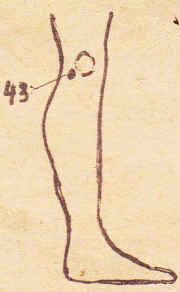
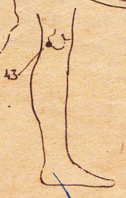

# 43 — Брюшная полость, головокружение, ноги.

**Сегмент:** [Руки і ноги — Точки надавливания на руках и ногах](_segment.md) · **Джерело:** стор. 18 (PDF стор. 16)

## Опис

Расположена на внутренней задней стороне мышелка под коленом. Связана с кишечником и селезенкой. Используется также при головокружениях.

## Зображення

*Под коленом: 43* — малюнок біля опису, стор. 18

*Тело сзади: сводная схема* — зведена схема, стор. 17

*Под коленом: 43* — зведена схема, стор. 17

## У покажчику («Указатель»)

- Надпочечники
- Головокружение
- Обморок
- Колени
- Боль: колени
- Боль: поджелудочная железа — правая
- Коленная чашка
- Селезенка — левая

→ [Повний покажчик](../kody/ukazatel.md)
