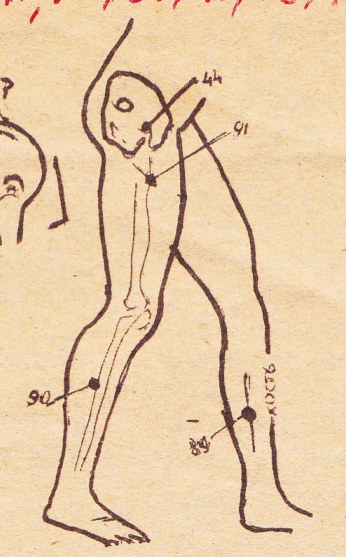
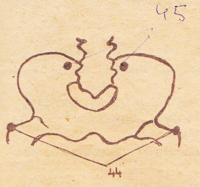
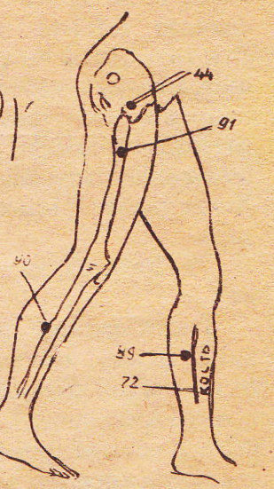
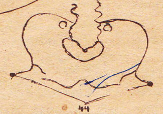

# 44 — Запор, подвздошные кости, кишечник, растяжение суставов, напряженное состояние.

**Сегмент:** [Руки і ноги — Точки надавливания на руках и ногах](_segment.md) · **Джерело:** стор. 19 (PDF стор. 17)

## Опис

Прежде мы рассматривали точку на внутренней стороне бедренной кости. Теперь рассмотрим боковую точку на головке или выпуклости каждого большого вертела. Снимает напряженное состояние в любой части тела, лечит также подвздошные кости и кишечник. Вертел - это часть головки тазобедренной кости, ее легче найти в сидячем положении. Давите это место во всех случаях запора, при любых растяжениях и напряженных состояниях.

## Зображення

*Ноги: 44, 91, 90, 89* — малюнок біля опису, стор. 19

*Таз: 44 (от руки: 45)* — малюнок біля опису, стор. 19

*Тело спереди: сводная схема* — зведена схема, стор. 17

*Ноги: 44, 91, 90, 89, 72* — зведена схема, стор. 17

*Таз: 44* — зведена схема, стор. 17

## У покажчику («Указатель»)

- Боль в бедре
- Кишечник
- Ожирение
- Боль: бедра
- Напряженное состояние

→ [Повний покажчик](../kody/ukazatel.md)
