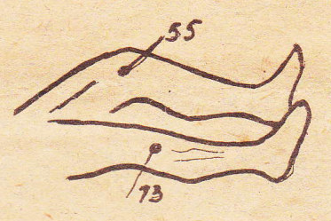
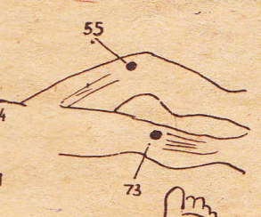

# 55 — Кишечник.

**Сегмент:** [Руки і ноги — Точки надавливания на руках и ногах](_segment.md) · **Джерело:** стор. 18 (PDF стор. 16)

## Опис

Расположено на внутренней стороне бедренной кости по всей ее длине. Это место болезненно почти у всех, т.к. почти все имеют то или иное нарушение равновесия. Эти центры лечат кишечник.

## Рукописні нотатки власника

- В покажчику дописано від руки: «спотикання - 55».

## Зображення

*Ноги: 55, 73* — малюнок біля опису, стор. 18

*Тело сзади: сводная схема* — зведена схема, стор. 17

*Бедро и голень: 55, 73* — зведена схема, стор. 17

## У покажчику («Указатель»)

- Запор
- Кишечник
- спотикання (рукописне)

→ [Повний покажчик](../kody/ukazatel.md)
