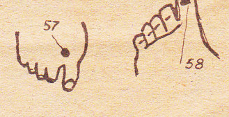
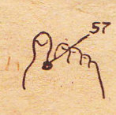

# 57 — Сужение канала мочевого пузыря и мочеточника, судороги.

**Сегмент:** [Руки і ноги — Точки надавливания на руках и ногах](_segment.md) · **Джерело:** стор. 20 (PDF стор. 18)

## Опис

Большим и указательным пальцами сжимайте ткань между большим и вторым пальцами ног. Эта точка лечит мышечные спазмы, сужение выходного отверстия мочевого пузыря, а также мочеточников. (Мочеточник - это трубки, идущие от почек к мочевому пузырю). Если в мочеточнике имеется почечный камень, эта точка очень болезненна. Камень в этой области на правой стороне дает даже симптомы аппендицита, и больной будет испытывать сильную боль. Точка "57" снимает напряженность в обоих мочеточниках и в мочевом пузыре, а также мышечные судороги. (При почечных камнях лечите точку ["33"](../03-tulub/33.md), стр. 12).

## Зображення

*Пальцы ног: 57, 58* — малюнок біля опису, стор. 20

*Тело спереди: сводная схема* — зведена схема, стор. 17

*Пальцы ног: 57* — зведена схема, стор. 17

## У покажчику («Указатель»)

- Менструальные боли
- Болезненное мочеиспускание
- Задержка мочеиспускания

→ [Повний покажчик](../kody/ukazatel.md)
