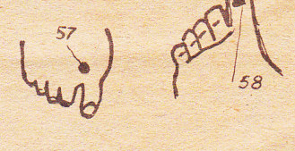
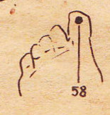

# 58 — Дыхание, легкие, гипофиз.

**Сегмент:** [Руки і ноги — Точки надавливания на руках и ногах](_segment.md) · **Джерело:** стор. 20 (PDF стор. 18)

## Опис

Середина нижней стороны большого пальца - это нервная точка, связанная с гипофизом, а также с легкими, в некоторых случаях с затрудненным дыханием. Надавливайте на эту точку до тех пор, пока не почувствуете, что палец немного онемел. После этого подержите палец еще некоторое время. Никогда нельзя забывать про эту точку в случаях проблем, связанных с дыханием. Обрабатывайте эту точку в случае гриппа.

## Зображення

*Пальцы ног: 57, 58* — малюнок біля опису, стор. 20

*Большой палец ноги: 58* — зведена схема, стор. 17

## У покажчику («Указатель»)

- Дыхание
- Грипп, грудь
- Легкие
- Гипофиз

→ [Повний покажчик](../kody/ukazatel.md)
