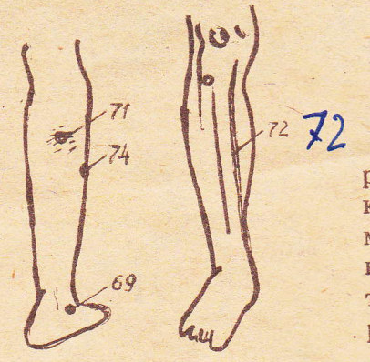
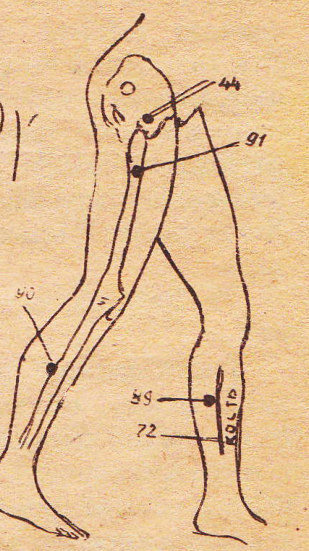
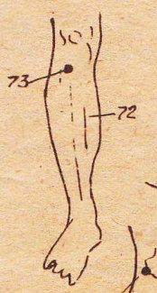

# 72 — Толстая кишка.

**Сегмент:** [Руки і ноги — Точки надавливания на руках и ногах](_segment.md) · **Джерело:** стор. 18 (PDF стор. 16)

## Опис

Это место расположено вдоль всей внутренней стороны большеберцовой кости на обеих ногах. Надавливание вдоль этих костей лечит нервы толстой кишки. Массаж только легкий, т.к. даже слабое прикосновение может быть чрезвычайно болезненным. Очень важное место.

## Зображення

*Голень: 71, 74, 69, 72* — малюнок біля опису, стор. 18

*Тело спереди: сводная схема* — зведена схема, стор. 17

*Ноги: 44, 91, 90, 89, 72* — зведена схема, стор. 17

*Голень: 73, 72* — зведена схема, стор. 17

## У покажчику («Указатель»)

- Колит
- Толстая кишка
- Понос
- Дивертикул
- Рассеянный склероз

→ [Повний покажчик](../kody/ukazatel.md)
