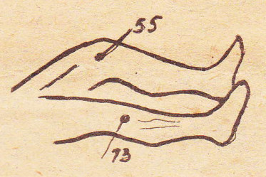
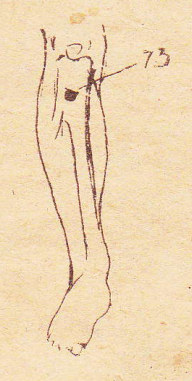
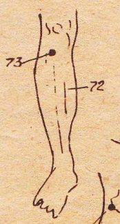
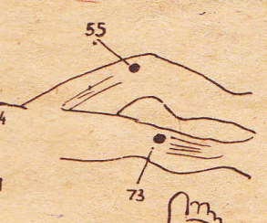

# 73 — Лимфа брюшной полости, диабет, глаза, стопы ног. Мышцы, щитовидная железа.

**Сегмент:** [Руки і ноги — Точки надавливания на руках и ногах](_segment.md) · **Джерело:** стор. 18 (PDF стор. 16)

## Опис

Расположена на передневерхней стороне ног в месте раздвоения большеберцовой и малоберцовой кости. Это вторая и самая важная точка, связанная с лимфой брюшной полости. Эта точка оказывает действие на область от места прикрепления ахиллова сухожилия сзади на пятке, вверх по задней части ноги до крестцовой области, где она стимулирует половые железы в паху и всю лимфатическую систему в брюшной полости. Надавливание на эту область оказывает тонизирующее действие на пожилых людей, полезно для мышц ног и всего тела, лечит вздутие живота, показано во всех случаях, когда стопы ног болезненны и испытывают ощущение жжения, показано при диабете и болезни щитовидной железы, полезно для глаз, которые болезненны или выпучены.

## Зображення

*Ноги: 55, 73* — малюнок біля опису, стор. 18

*Голень: 73* — малюнок біля опису, стор. 18

*Тело спереди: сводная схема* — зведена схема, стор. 17

*Голень: 73, 72* — зведена схема, стор. 17

*Бедро и голень: 55, 73* — зведена схема, стор. 17

## У покажчику («Указатель»)

- Половые железы
- Лимфатические сосуды брюшной полости
- Отек брюшной полости
- Ахиллово сухожилие
- Лодыжка
- Глухота
- Диабет
- Переваривание сахара
- Уши
- Глаза: дегенерация
- Глаза: выпученные глаза
- Стопа
- Стопа горячая
- Сердце: эмоциональные
- Инсулин
- Йод
- Лимфа
- Сахар

→ [Повний покажчик](../kody/ukazatel.md)
