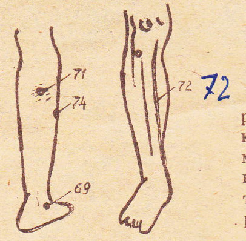
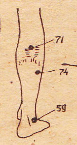

# 74 — Мышцы.

**Сегмент:** [Руки і ноги — Точки надавливания на руках и ногах](_segment.md) · **Джерело:** стор. 18 (PDF стор. 16)

## Опис

Расположена на заднебоковой стороне ножных мышц. Перемещайте руку по контуру мышц вниз. Показана для мышц ног и всего тела.

## Зображення

*Голень: 71, 74, 69, 72* — малюнок біля опису, стор. 18

*Тело сзади: сводная схема* — зведена схема, стор. 17

*Голень сзади: 71, 74, 69 (на схеме подписано «59»)* — зведена схема, стор. 17

## У покажчику («Указатель»)

- Дистрофия мышечная
- Мышцы
- Ишиас

→ [Повний покажчик](../kody/ukazatel.md)
