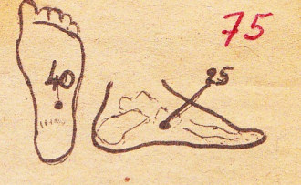
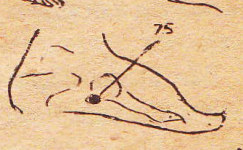

# 75 — Дыхание, селезенка, поджелудочная железа.

**Сегмент:** [Руки і ноги — Точки надавливания на руках и ногах](_segment.md) · **Джерело:** стор. 19 (PDF стор. 17)

## Опис

Расположена на боковой стороне стопы. Давите большим пальцем на плюсну. Эти точки на обеих стопах действуют на селезенку и поджелудочную железу, а иногда даже на дыхание.

## Зображення

*Стопа: 40, 75* — малюнок біля опису, стор. 19

*Стопа сбоку: 75* — зведена схема, стор. 17

## У покажчику («Указатель»)

- Дыхание
- Боль: поджелудочная железа — правая
- Боль: селезенка — левая
- Поджелудочная железа — правая
- Селезенка — левая

→ [Повний покажчик](../kody/ukazatel.md)
