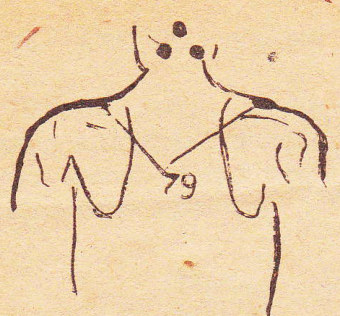
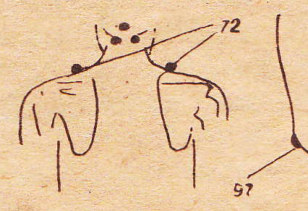

# 79 — Энергия, напряжение.

**Сегмент:** [Руки і ноги — Точки надавливания на руках и ногах](_segment.md) · **Джерело:** стор. 18 (PDF стор. 16)

## Опис

Расположена посередине между основанием шеи и плечом. Снимает напряжение в плечах и руках, а также повышает теплоту и энергию во всем теле.

## Зображення

*Плечи: 79* — малюнок біля опису, стор. 18

*Тело сзади: сводная схема* — зведена схема, стор. 17

*Плечи: 79 (на схеме подписано «72»)* — зведена схема, стор. 17

## У покажчику («Указатель»)

- Атаксия
- Энергия
- Пульс,повысить
- Плечевые кости

→ [Повний покажчик](../kody/ukazatel.md)
