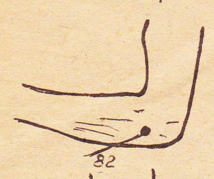
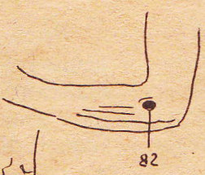

# 82 — Кровообращение в предплечьях и в кистях рук.

**Сегмент:** [Руки і ноги — Точки надавливания на руках и ногах](_segment.md) · **Джерело:** стор. 18 (PDF стор. 16)

## Опис

Как видно на схеме, эта точка расположена на предплечье, в том месте, где начинаются лучевая и локтевая кости. Надавливание в этом месте контролирует состояние рук и даже головы. Некоторые анатомы полагают, что эта точка влияет на выделение слизистой. Если т. "82" болезненна на противоположной стороне руки, давите обе стороны одновременно. Усиливает кровообращение в предплечье и в кисти.

## Зображення

*Предплечье: 82* — малюнок біля опису, стор. 18

*Тело сзади: сводная схема* — зведена схема, стор. 17

*Предплечье: 82* — зведена схема, стор. 17

## У покажчику («Указатель»)

- Руки
- Пальцы
- Мышцы

→ [Повний покажчик](../kody/ukazatel.md)
