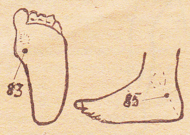
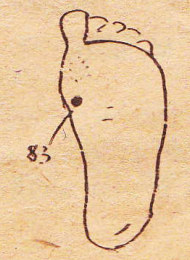

# 83 — Сумка на наружной стороне большого пальца ноги (от изменения формы пальца и давления тесной обуви), подагра, простата, органы размножения.

**Сегмент:** [Руки і ноги — Точки надавливания на руках и ногах](_segment.md) · **Джерело:** стор. 20 (PDF стор. 18)

## Опис

Эта точка расположена ниже выпуклого сустава у основания большого пальца. Скользите кончиком большого пальца руки по костному выступу, а потом давите вглубь, чтобы выяснить, не болезненна ли эта точка. Боль может указывать на серьезный застой крови в органах размножения. Лечит также опухоль на большом пальце.

## Зображення

*Стопа: 83, 85* — малюнок біля опису, стор. 20

*Подошва: 83* — зведена схема, стор. 17

## У покажчику («Указатель»)

- Половые железы
- Подагра
- Колени
- Менструация
- Яичники
- Предстательная железа
- Половые органы
- Секс

→ [Повний покажчик](../kody/ukazatel.md)
