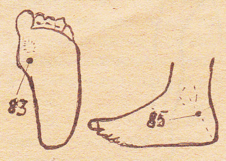
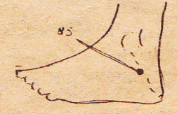

# 85 — Запор, подвздошные кости, легкие, слизистая.

**Сегмент:** [Руки і ноги — Точки надавливания на руках и ногах](_segment.md) · **Джерело:** стор. 20 (PDF стор. 18)

## Опис

Посередине между таранной костью и самой удаленной точкой на пятке находится еще одно место, связанное с подвздошными костями и легкими. Оно помогает выделению слизи, начиная с легких и кончая кишечником. Точку "85" всегда надо иметь в виду при запорах, а также в случае легочных проблем и проблем, связанных с подвздошными костями. Как видно из схемы, эти точки расположены на обеих сторонах обеих стоп. Эта точка менее важна, чем точка ["39"](../03-tulub/39.md) (см. стр. 11).

## Зображення

*Стопа: 83, 85* — малюнок біля опису, стор. 20

*Тело сзади: сводная схема* — зведена схема, стор. 17

*Стопа: 85* — зведена схема, стор. 17

## У покажчику («Указатель»)

_Не згадується._

→ [Повний покажчик](../kody/ukazatel.md)
