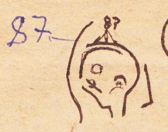
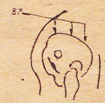

# 87 — Кишечник, ожирение.

**Сегмент:** [Руки і ноги — Точки надавливания на руках и ногах](_segment.md) · **Джерело:** стор. 19 (PDF стор. 17)

## Опис

Это место расположено вдоль гребешка бедренных костей. Нажимайте большими пальцами на обе бедренные кости одновременно. Давите на болезненные точки, это поможет вашему кишечнику. Поскольку замедленное действие кишечника связано с ожирением, используйте точки "87" и ["44"](44.md) каждый день, если увеличение веса является для вас проблемой. Эти точки помогают также пищеварению и усваиванию аминокислот.

## Зображення

*Гребень бедренных костей: 87* — малюнок біля опису, стор. 19

*Гребень бедренных костей: 87* — зведена схема, стор. 17

## У покажчику («Указатель»)

- Кишечник
- Ожирение
- Боль: бедра
- Паращитовидные железы

→ [Повний покажчик](../kody/ukazatel.md)
